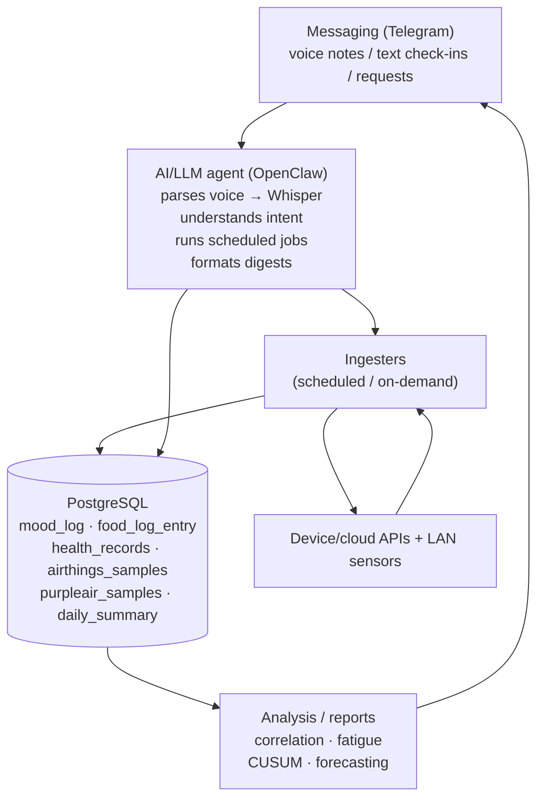

# ⌂ Personal Health Data Stack

*An agent-driven personal analytics setup — the umbrella that ties the ingester repos together.*

This repo is the **map**, not the code. The actual pipelines live in focused sibling repos (linked below). The whole system runs on a home computer (macOS here) with an AI/LLM agent (OpenClaw) as the orchestrator: it listens in chat, parses voice notes, writes to PostgreSQL, and produces reports. **Mood and food logging are verbal-first** — you speak, the agent transcribes and logs.

## The big picture

**How it works in practice:**
1. **Capture (verbal)** — the user speaks a voice note ("mood 7, had a rough meeting") or a food log ("lunch: chicken sandwich") into Telegram, or types it. The agent transcribes it (Whisper) and inserts it.
2. **Store** — sensors (Airthings, PurpleAir) push on cron to PostgreSQL; the Apple Watch exports via a local receiver.
3. **Analyze** — nightly and weekly jobs compute food kJ estimation, mood modeling, fatigue scores, and correlations.
4. **Report** — the agent renders tables as images (Telegram-friendly) and posts digests to chat/Discord.

## Repos in the stack

| Repo | What it does |
|------|--------------|
| [verbal-mood-logging](https://github.com/dpwilcock/verbal-mood-logging) | **Verbal** mood check-in logging — voice-note transcription + scoring (LLM processors), mood vs. workload modeling |
| [verbal-food-logging](https://github.com/dpwilcock/verbal-food-logging) | **Verbal** free-text food logging — speak what you ate, agent + Whisper transcribe; number-word normalization, nightly kJ estimation |
| [apple-health-data-monitor](https://github.com/dpwilcock/apple-health-data-monitor) | Apple Watch / Health data → Postgres (local receiver), fatigue & correlation analysis |
| [airthings-sync](https://github.com/dpwilcock/airthings-sync) | Airthings indoor-air sensors → Postgres, resumable backfill |
| [purpleair-sync](https://github.com/dpwilcock/purpleair-sync) | PurpleAir outdoor-air sensor → Postgres, live LAN + cloud history |

See also: [municipal-council-watchdog](https://github.com/dpwilcock/municipal-council-watchdog) — the civic sibling (same agent orchestration, but JS→Discord rather than Postgres ingestion).

## Shared conventions

- **PostgreSQL** is the single store: one database, several schemas.
- **Schema name** is configurable via `PGSCHEMA` env var (default `"DW Health"` — the personal-health schema).
- **No secrets in repos** — all credentials come from environment variables (see each repo's README).
- **Idempotent writes** — inserts use `ON CONFLICT DO NOTHING` / upserts, so re-runs are safe.
- **Env-var config** everywhere: `PGDATABASE`, `PG_DSN`, `LOG_FILE`, `HEALTH_HOST`/`HEALTH_PORT`, etc.

## What I've learned

- **Low friction is the whole game.** Verbal (voice-note) logging is what made daily logging stick — typing a mood score was a chore; speaking it isn't. Any habit system that adds a step after the moment dies.
- **Idempotent writes saved me.** Cron jobs double-fire, agents retry, imports get re-run. `ON CONFLICT DO NOTHING` means none of that corrupts anything.
- **The agent is the glue, not the pipes.** The interesting work is parsing intent and presenting answers; the ingesters stay dumb and small.
- **Keep the why in the README.** The pattern is copyable; the motivation is what someone actually needs to steal.

## Adding your own data

Use the same shape:
1. Pick or write an ingester repo (they're small; fork one).
2. Point it at your Postgres via `PG_DSN` / `PGDATABASE` / `PGSCHEMA`.
3. Schedule it (cron works; the agent can also trigger on chat requests).
4. Add reporting: the agent's job is turning rows into answers.

## License

MIT, per-repo. This umbrella is just documentation. Shared as-is with no support or warranty.